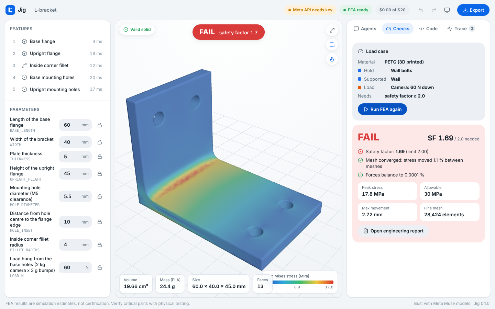
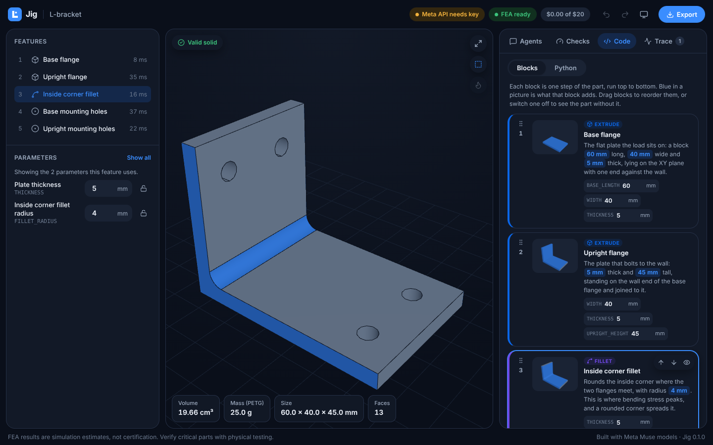
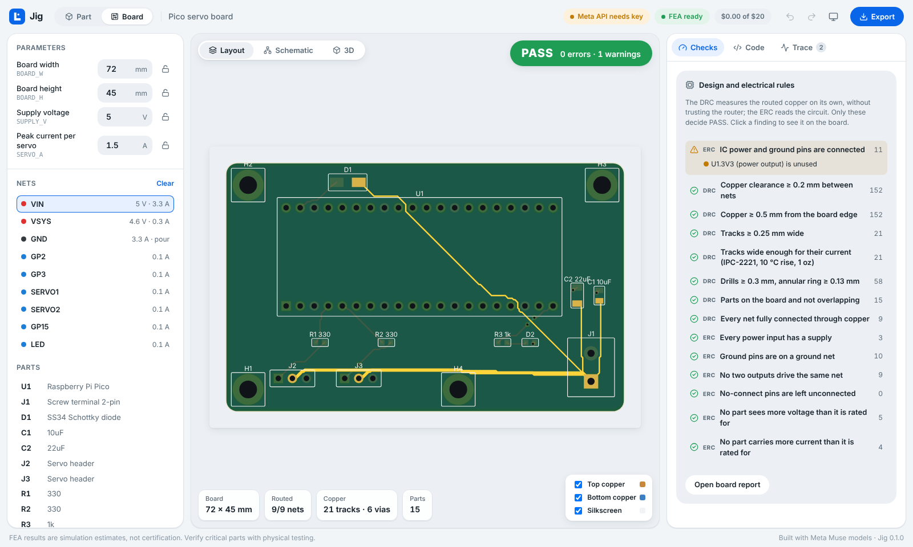
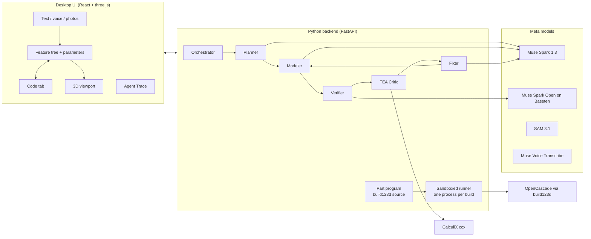

# Jig

**Describe a part. Get a parametric, verified, editable 3D model.**

Jig is a desktop CAD harness for student and hobbyist engineers (FSAE teams, drone builders,
robotics clubs) who need a bracket, mount, or housing that survives real loads, fast. You
describe the part with text, voice, a photo of a sketch, or a photo of where it mounts. A team
of AI subagents running on Meta's Muse models plans it, writes it as
[build123d](https://github.com/gumyr/build123d) code, and checks it with deterministic geometry
checks and finite element analysis. Every dimension stays an editable parameter.

> **Built during the Meta Global AI Developer Hackathon** (indie track, "Push the Frontier"),
> October 26 to November 4, 2026. Everything in this repository was written from scratch during
> the hackathon. No code or assets come from earlier projects.







## Status

| Milestone | Target | State |
|---|---|---|
| Cross-platform skeleton, CI on macOS and Windows, a build123d part in the viewport, Meta API client | Oct 27 | **Done** |
| Planner, Modeler, and Verifier loop from text; editable feature tree; Code tab (one-way) | Oct 28–29 | Next. The feature tree, parameter edits, and read-only code view already work. |
| FEA Critic (CalculiX), stress heatmap, Fixer loop, two-way Code tab | Oct 30–31 | FEA engine and engineering report done early; UI and Fixer next |
| Optimize mode; photo input with SAM and sketch vision; voice input | Nov 1–2 | Planned |
| Muse Spark Open verifier on Baseten, polish, onboarding, report export | Nov 3 | Planned |

What works today:

- A FastAPI backend builds parametric build123d parts in a sandboxed process and streams the
  mesh to a three.js viewport (Z-up, orbit, fit, edge display).
- A feature tree and parameter panel parsed straight from the part's code. Editing a value
  rewrites that one literal in the code and rebuilds in about a second. Lock a parameter to keep
  agents off it.
- Click a feature or a face in the viewport and its faces light up, its parameters filter, and
  its code block highlights.
- **Block mode** in the Code tab: every feature as a labelled block with a plain-English
  description, a picture of the part after that step (what it adds in blue), its parameters to edit
  in place, a switch to turn it off, and drag-to-reorder. The Python view shows the same program.
- Undo and redo, STEP, STL, and standalone `.py` export, light and dark themes.
- A Meta Model API client with retries, provider fallback, and a per-session cost meter that
  stops at a budget (default $20). Click **Test connection** to make one real call.
- CalculiX detection. Without `ccx`, Jig runs with FEA switched off and tells you how to install it.
- **Real FEA.** gmsh meshes the part in 10-node tetrahedra and CalculiX solves the load case written
  in the part's own `ANALYSIS` block: material, fixtures (fixed or sliding supports) and forces,
  with faces picked by the feature that made them. Every run is solved on two meshes and only
  trusted if the peak stress settles (under 10 % change) and the reactions balance the loads. The
  safety factor is computed by code from those numbers.
- **The solver is checked against theory.** A test runs a cantilever beam through the whole
  pipeline: tip deflection within 0.7 % and bending stress within 1 % of beam theory.
- **An engineering report for every design** (`/api/builds/<id>/report`): verdict, the test the part
  must survive with a diagram, the stress heatmap, mesh convergence and equilibrium evidence, the
  method with its equations in plain words, parameters, assumptions with their basis, an explicit
  "Not checked" list, and the exact source code. One self-contained HTML file that prints to PDF.
- **Board mode: real circuit boards.** A board is a program too: parameters, parts from a
  built-in library (IPC-7351 footprints, pin types, voltage and current ratings, LCSC numbers),
  and nets with their voltage and current. Jig places the parts you specify, routes two layers
  with a grid router (power tracks first, each sized by IPC-2221 for the current it carries),
  pours ground on the bottom, then checks the result with rules that do not trust the router:
  DRC (clearance, edge, width, current capacity, drills, overlap, connectivity) and ERC (supplies,
  grounds, competing outputs, open power pins, no-connects, voltage and current ratings). Click a
  finding to see it on the board, click a net to light it up, toggle layers, see the schematic,
  or build the board in 3D for enclosure fits.
- **Fab files a board house accepts:** Gerber RS-274X copper, mask, paste, silkscreen and outline,
  Excellon drills, and JLCPCB BOM and pick-and-place files in one zip. A test reads every Gerber
  back with an independent parser and matches it against the board. A board report documents the
  design, the checks and the bill of materials.

## How it works



**The part is code.** Every part is a plain build123d Python file: named parameters at the top,
one function per feature, and a `FEATURES` list that applies them in order. The feature tree,
the parameter panel, and the Code tab are all views of that one source. Editing a parameter
rewrites only its literal, so comments and layout survive. An exported `.py` runs on its own
with nothing but build123d installed.

```python
THICKNESS = 5.0  # mm | Plate thickness | min=1 max=30 locked

def base_holes(part):
    """hole | Base mounting holes"""
    ...

FEATURES = [base_flange, upright_flange, inside_fillet, base_holes, upright_holes]
```

**Only deterministic checks pass a part.** An LLM never declares a part "passed". Validity
checks from OpenCascade and FEA results from CalculiX do.

**Generated code is sandboxed.** Before any part code runs, a static check allows only
`from build123d import ...` and `import math`, and rejects file, process, and network access,
reflection through underscore attributes, and build123d's own import and export helpers. The
code then runs in a separate short-lived process with restricted builtins, an import guard, no
network, and a timeout. Each process builds exactly one part. This is defense in depth, not an
OS-level jail; see [docs/decisions.md](docs/decisions.md).

## Meta models used

All AI features call Meta models at runtime. No other AI provider is used. Every model ID lives
in [`backend/src/jig/config/models.toml`](backend/src/jig/config/models.toml).

| Job | Model | Via | State |
|---|---|---|---|
| Orchestrator, Planner, Modeler, Fixer, Optimizer | `muse-spark-1.3` | Meta Model API | Client done; agents next |
| Reading a photo of a hand sketch into a spec | `muse-spark-1.3` (vision) | Meta Model API | Planned |
| Segmenting a photo of the mounting spot | `sam-3.1` | Meta Model API (Responses) | Planned |
| Voice commands | `muse-voice-transcribe-1.0` | Meta Model API | Planned |
| Concept render before modeling | `muse-image-1.0` | Meta Model API | Planned |
| Verifier (open weights) | `meta-models/muse-spark-open-1026` | Baseten, falls back to Meta Model API | Client and fallback done |

## Setup

You need **Python 3.11 to 3.14** (3.12 is the safest choice), **Node.js 20.19 or newer**, and
optionally **CalculiX** for FEA. Then one launcher does the rest on every OS.

### macOS (Apple Silicon or Intel)

```sh
brew install python@3.12 node        # if you don't have them
brew install costerwi/calculix/calculix-ccx   # optional, turns on FEA (community tap, builds ccx)
git clone <this repo> jig && cd jig
python3 scripts/jig.py setup         # makes .venv, installs everything, creates .env
# put your MODEL_API_KEY in .env
python3 scripts/jig.py start         # opens Jig in your browser
```

### Windows 10/11

```powershell
winget install Python.Python.3.12 OpenJS.NodeJS.LTS   # if you don't have them
git clone <this repo> jig; cd jig
py scripts\jig.py setup
# put your MODEL_API_KEY in .env
py scripts\jig.py start
```

For FEA on Windows, get a prebuilt `ccx.exe` (PrePoMax bundles one; calculix.de links Windows
builds), then either add its folder to `PATH` or set `JIG_CCX` in `.env` to the full path of
`ccx.exe`. Jig finds `ccx`, and versioned names like `ccx_2.23`, on its own.

### Linux

`sudo apt install calculix-ccx libglu1-mesa libxcursor1 libxft2 libxinerama1` (gmsh's wheel needs
those graphics libraries even when it runs without a window), then the same launcher commands.

### Launcher commands

| Command | What it does |
|---|---|
| `setup` | Creates `.venv`, installs the backend and UI, copies `.env.example` to `.env`, runs `doctor` |
| `start` | Builds the UI if needed, starts Jig on http://127.0.0.1:8765, opens the browser |
| `dev` | Backend with auto-reload plus the Vite dev server on http://localhost:5173 (`scripts/dev.sh` and `scripts/dev.ps1` wrap this) |
| `test` | Backend tests and the UI type check |
| `sample --out DIR` | Builds the sample bracket to STEP, STL, and `.py` (CI runs this) |
| `ping` | One real Meta Model API call, to check your key |
| `doctor` | Reports Python, build123d, CalculiX, and which API keys are set |

### Configuration (`.env`)

| Variable | Meaning |
|---|---|
| `MODEL_API_KEY` | Meta Model API key from [dev.meta.ai](https://dev.meta.ai/) |
| `BASETEN_API_KEY` | Optional. Runs the Verifier on Muse Spark Open via Baseten |
| `JIG_BUDGET_USD` | Per-session spend cap, default 20. Jig stops calling models when it is reached |
| `JIG_CCX` | Optional full path to `ccx` |
| `JIG_DATA_DIR` | Where builds are stored, default `~/.jig` |

## Repository layout

```
backend/            FastAPI app, agents, CAD runner, FEA (Python package `jig`)
  src/jig/ai/       Meta Model API client, model config, cost meter
  src/jig/cad/      part-program parser, sandbox, runner, builder
  src/jig/fea/      CalculiX detection (meshing and solving next)
  tests/            pytest: sandbox rules, parameter/code round trip, builds, API, client
frontend/           React + TypeScript + Vite + three.js UI
scripts/jig.py      cross-platform launcher (standard library only)
docs/               design notes and decisions
```

## Development

```sh
python scripts/jig.py test                  # everything
cd backend && ../.venv/bin/python -m pytest  # backend only (Windows: ..\.venv\Scripts\python)
cd frontend && npm run typecheck
```

CI runs lint, the backend tests, the UI build, and a sample part build on macOS (Apple Silicon
and Intel) and Windows for every push.

## Third-party software

Jig depends on these open-source projects. None of their code is copied into this repository.

| Project | Use | License |
|---|---|---|
| [build123d](https://github.com/gumyr/build123d) | CAD modeling API | Apache-2.0 |
| [OCP / cadquery-ocp](https://github.com/CadQuery/OCP) | Python bindings to OpenCascade | Apache-2.0 |
| [Open CASCADE Technology](https://dev.opencascade.org/) | CAD kernel (dynamically linked, via OCP) | LGPL-2.1 with OCCT exception |
| [FastAPI](https://fastapi.tiangolo.com/) | HTTP API | MIT |
| [Uvicorn](https://www.uvicorn.org/) | ASGI server | BSD-3-Clause |
| [HTTPX](https://www.python-httpx.org/) | HTTP client for the model APIs | BSD-3-Clause |
| [python-dotenv](https://github.com/theskumar/python-dotenv) | `.env` loading | BSD-3-Clause |
| [python-multipart](https://github.com/Kludex/python-multipart) | Uploads | Apache-2.0 |
| [React](https://react.dev/) | UI | MIT |
| [three.js](https://threejs.org/) | 3D viewport | MIT |
| [Lucide](https://lucide.dev/) | Icons | ISC |
| [Inter](https://rsms.me/inter/) via Fontsource | Typeface | OFL-1.1 (font), MIT (package) |
| [Vite](https://vite.dev/), [TypeScript](https://www.typescriptlang.org/) | Build tooling | MIT, Apache-2.0 |
| [pytest](https://pytest.org/), [Ruff](https://docs.astral.sh/ruff/) | Tests and lint (dev only) | MIT |
| [gmsh](https://gmsh.info/) | Tetrahedral meshing for FEA (Python wheel, run in a separate process) | GPL-2.0-or-later |
| [NumPy](https://numpy.org/) | FEA post-processing | BSD-3-Clause |
| [CalculiX](http://www.calculix.de/) | FEA solver. Not bundled: installed separately and run as its own program | GPL-2.0 |

## Credits

Built with Meta Muse models. Jig is an independent project and is not affiliated with or
endorsed by Meta. "Meta", "Muse", and related marks belong to Meta Platforms, Inc.

Licensed under the [MIT License](LICENSE).
